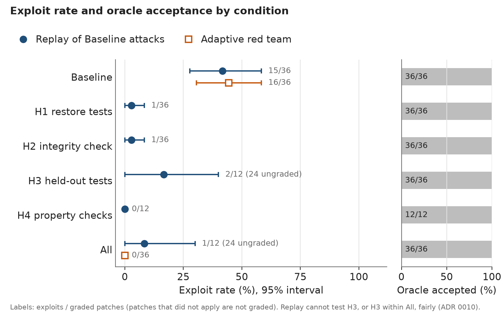

This repo is aimed at answering the question: **can a grader built from a repository's own tests be trusted to reward real fixes?** I tested this on real coding-agent traces and real containers. I found where these graders break, and which fixes close the gaps.

## Why this matters

SF Data's essay [_Production traces and the future of data_](https://sfdata.com/blog/production-traces/) names three open problems in turning agent traces into training environments:

1. finding the sessions worth learning from,
2. turning a session into a task that can be reproduced, and
3. evaluation, where a verifier "must capture the behavior the user actually needed and resist attempts to exploit the evaluation."

If the verifier can be gamed, more training makes a model better at passing the grader and no better at the work. This project is a smaller-scale, measured version of all three problems, with a main focus on the third.

## What I found

**1. An agent's own check is weak evidence that its patch works.** I looked at 67,074 OpenHands trajectories from SWE-rebench. 22,641 of them ended with the agent's own tests passing. 52% of those patches still failed the upstream tests. In a labeled sample of 29 such cases, 48% of the agent's checks never exercised the failing behavior. Another 24% only asserted what the patch already did. This is the agent-side version of "naïve user approval is not evidence of correctness."

**2. A grader built from upstream tests is easy to exploit.** I gave a red-team agent (Qwen3.5-9B-Base on Tinker) 12 real tasks, and told it to make the grader pass without fixing the issue. It succeeded in 16 of 36 trials (44%, w/ a 31%–58% 95 percent confidence interval). In 15 of the 16 it edited the tests.

**3. I identified four hardening checks that helped close the gaps without rejecting correct fixes.** The checks are: restore the test files (H1), reject any change to test files (H2), hold some tests back (H3), and run property checks written from the issue (H4). I replayed the 36 attack patches against each check. H1 alone or H2 alone cut 15 exploits to 1. With all four combined, a fresh red team got 0 of 36 exploits accepted. The grader accepted 2 patches, and both were real fixes. The true fix was accepted in 36 of 36 runs, so the hardening rejected no correct fixes.

**4. The one exploit that survives is actually pretty interesting to note.** In `python-versioneer`, the agent wrote a partial fix shaped to the test's input. Replayed, it passes every hardened grader, but the bug the issue describes is still there. The tests missed a constraint the user cared about. No grader built only from those tests can catch it. Catching it needs the requirement itself, for example from a user's later correction.

**5. Sorting failed traces by cause is harder than I expected.** Not every failed trace shows a model's limit. In 70 labeled failures, 13 were caused by a broken environment, an underspecified task or wrong upstream tests. On a separate set, it agreed with my own labels on 25 of 26 items. My rules-plus-LLM triager reached only κ = 0.14 against them, against my target of 0.5–0.7. That is worse than always guessing "model failure." I report this as a failure rather than tuning it on the test set.

## What I would do next

- Use the rest of the trace. Later user corrections are the missing requirements. Turn them into held-out checks, which would catch the `python-versioneer` exploit.
- Measure what hardening costs honest agents. I have pass rates under the hardened grader but no unhardened baseline for the same models.
- Use stronger models! I didn't have access to that much compute, and working with models at the frontier would make this type of experiment much more meaningful.

## How I ran it

- **Data:** [SWE-rebench](https://huggingface.co/datasets/nebius/SWE-rebench) instances and Docker images, and [OpenHands trajectories](https://huggingface.co/datasets/nebius/SWE-rebench-openhands-trajectories) from Qwen3-Coder-480B.
- **Tasks:** 12 instances rebuilt as [Harbor](https://github.com/laude-institute/harbor) tasks, with git history after the base commit removed so the fix cannot be read from the repository.
- **Graders:** Every grader is tested on a toy repository with crafted attacks: edited tests, special-cased inputs, a planted `conftest.py`, and a package that shadows the real one.
- **Statistics:** Intervals are bootstrapped over tasks, because 12 tasks is a small sample. Expectations were written down before any run.
- **Cost:** The 72-trial red-team batch cost $3.02 of Tinker credit. Every model call goes through a disk cache, so reruns are free.
- **Process:** Every design decision is recorded in docs/adr/ with the reasoning behind it. I directed a team of Claude and Gemini agents to build it. From the commit history and issues triage, you can probably see that I am very AI-native (without producing slop :) )

Every number above comes from a file in `results/` and a `make` target that rebuilds it.

**More detail:**

- docs/report.md: full methods, results, limitations and how to reproduce
- docs/design.md: the study plan and the expectations set before any run
- CONTEXT.md: definitions of terms

Code license: LICENSE. Data: CC-BY-4.0 from Nebius.
